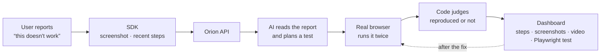

  

<h3 align="center">From “it's broken” to a verified bug, without a QA team.</h3>

  A user reports a bug in one sentence. Orion's AI reproduces it in a real browser, 
  judges it from what actually happened, and hands developers the evidence.

  <a href="https://orion-app-plum.vercel.app"><b>Open the dashboard</b></a>
  &nbsp;·&nbsp;
  <a href="https://github.com/NONAMEDKERNEL/Orion-sdk"><b>Install the SDK</b></a>

---

### How it works

- **Evidence, not opinions.** The verdict comes from two independent browser runs, not from the model's claim. If the runs disagree, Orion says so instead of guessing.
- **Retest the fix.** The same plan runs again on the fixed version, so "fixed" means the bug is gone.
- **Private by default.** Inputs, cookies and request bodies never leave the page. Screenshots are masked before upload, and recent activity is sent only with consent.

### Repositories

| | Repository | What it is |
| :-: | --- | --- |
| 🖥️ | [**Orion**](https://github.com/NONAMEDKERNEL/Orion) | Dashboard for reports, reproduction results, retests and widget settings · Next.js |
| ⚙️ | [**Orion-back**](https://github.com/NONAMEDKERNEL/Orion-back) | API and validation worker · FastAPI, PostgreSQL |
| 🧠 | [**Core_engine**](https://github.com/NONAMEDKERNEL/Core_engine) | Reproduction engine: interprets reports, plans, runs the browser and judges · Python, Playwright |
| 🧩 | [**Orion-sdk**](https://github.com/NONAMEDKERNEL/Orion-sdk) | One-line `<script>` bug-report widget for customer sites · TypeScript |
| 🧰 | [**Orion-harness**](https://github.com/NONAMEDKERNEL/Orion-harness) | Shared rules, skills and hooks for building Orion with coding agents |
| 🌐 | [**Orion-landing**](https://github.com/NONAMEDKERNEL/Orion-landing) | Static landing page |

### Built with agents

Orion is developed with AI coding agents in the loop. The harness keeps them honest: evaluation answers never reach the engine, real-model evaluations ask before they spend, and every change ships through tests and a reviewed pull request.

© NONAMEDKERNEL · Orion

